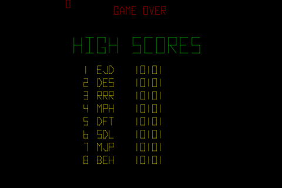
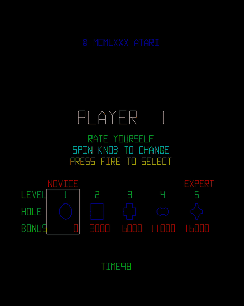
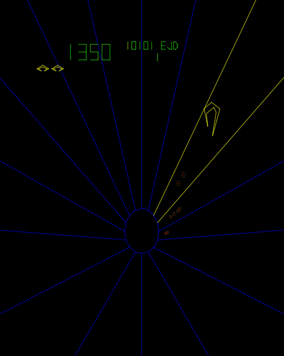
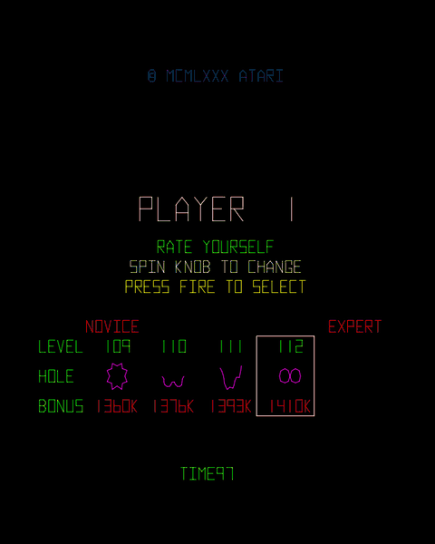
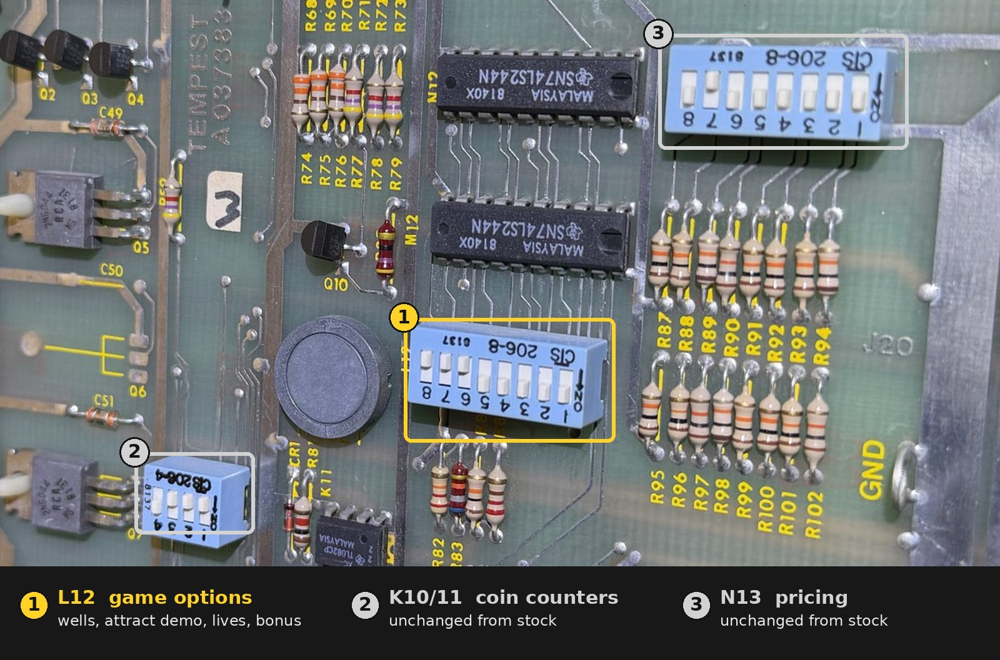
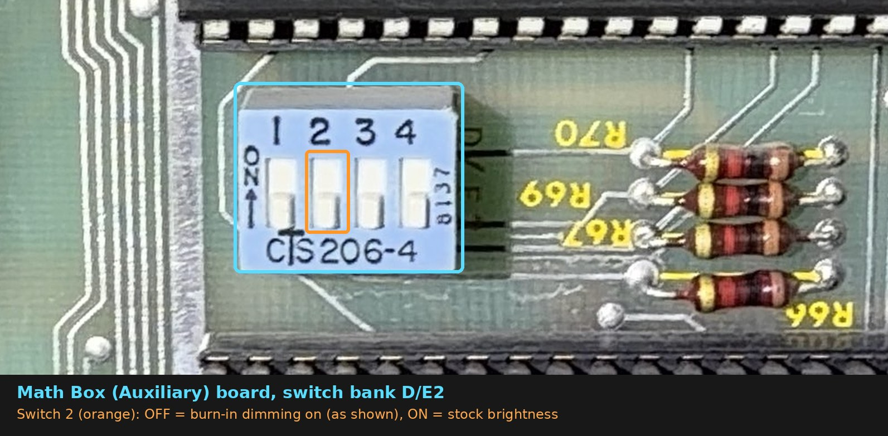
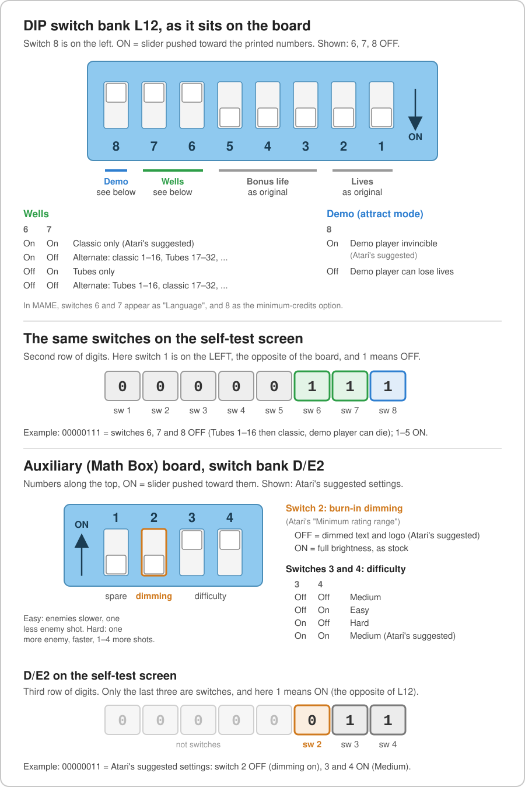

# TEMPEST² — the classic, turbocharged

*Same cabinet, all-new tricks. Swap in ten chips and your Tempest gets a whole new lease of life.*

Tempest² is an unofficial upgrade for the Atari Tempest arcade machine (the 12-ROM Revision 3 board). It is also playable in MAME.

- **Real machine:** see [BURNING.md](BURNING.md) for which EPROMs to burn and where they go.
- **MAME:** see [MAME.md](MAME.md).
- **Checksums** for every file are in [CHECKSUMS.md](CHECKSUMS.md).

Please read the [disclaimer](#disclaimer) before using these files.

> **New in v1.2:** burn-in protection for the title sequence, based on a study of a real worn tube, and a switch to turn the dimming off. See [Kind to your cabinet](#kind-to-your-cabinet) and the new [switch guide](#dip-switch-settings).

## See it in action

<table>
  <tr>
    <td align="center"> <b>Title screen</b> Dimmed while small, a new colour and size every time, the superscript 2 and a gentle fade</td>
    <td align="center"> <b>Level select</b> Spin left from 1 to wrap to 112; Tubes wells from level 17</td>
  </tr>
  <tr>
    <td align="center"> <b>Hyperspace jump</b> Light-speed streaks between levels</td>
    <td align="center"> <b>Level 112</b> Straight to the purple levels, with a 1.41 million start bonus</td>
  </tr>
</table>

*Recorded in MAME.*

## What's new

### Twice the worlds: 32 well designs
- **Tempest Tubes built in.** Atari gave you 16 well shapes, and then the game started repeating them. Tempest² adds all 16 shapes from Duncan Brown's legendary Tempest Tubes hack alongside them, for **32 different well designs before you see a repeat**.
- **You choose the mix** with two DIP switches (see [DIP switch settings](#dip-switch-settings)): classic only, Tubes only, or alternating every 16 levels.

### More game
- **112 levels.** Clear the greens and the purple levels are waiting: 97 to 112, faster, meaner and with a third Superzapper to help you survive them.
- **Start anywhere, 1 to 112.** Feeling brave? Jump in at level 112 and collect a start bonus of up to 1,410,000 points. You get **99 seconds** to make up your mind.
- **Wrap-around level select.** Spin left from level 1 and you're at 112 in a flick.
- **Pick up where you left off.** Lose your last life and the selector opens on the level you were playing.

### Bigger numbers
- **Seven-digit scores.** Your score keeps climbing past 999,999.
- **Three-digit levels**, shown in full.
- **Bragging rights.** The high-score table shows the level each top-8 player reached, and remembers it after power-off.

### Eye candy
- **Hyperspace jump\*.** The star field between levels now streaks past as light-speed trails. As a bonus, it no longer jumps between some levels, a glitch in Atari's original.
- **Depth you can feel.** The far end of the well glows dimmer, so the tunnel really drops away from you.
- **Tempest²!** The title screen now carries a superscript 2, so everyone knows this isn't your grandad's Tempest.

### Kind to your cabinet
A Tempest left switched on spends most of its life in attract mode, drawing the same pictures in the same places for hours on end. We photographed the burn-in on a real, well-used Tempest tube and studied where the wear actually is. The worst of it isn't the text. It's a cone converging on the centre of the screen, burned by the title sequence: the burst of rectangles and the tiny TEMPEST logos that start there pile dozens of lines on top of each other in one small spot, every time the title comes round. A fainter outline of the logo and of the attract-mode text showed too. Tempest² now goes easy on all of these:

- **Title burst dimmed by size\* (new in v1.2).** The rectangles and logo copies take a brightness from their size: full brightness at full size, falling as they shrink toward the centre. The smallest are drawn at the brightness of the faintest line in the self-test's colour-bar pattern, so they're still visible on a real monitor while putting far less wear where it was worst.
- **Screen-saver title logo.** The TEMPEST logo lands in a different colour and size each time, then gently fades out\*, so it never burns the same outline.
- **Softer attract text\*.** While the machine waits for players, the copyright, coin and start messages, the high-score table and the scores glow at a gentler brightness. Start a game and everything is back to full brightness.
- **No more bright dots (new in v1.2).** The full stop after each rank in the high-score table was drawn as a single spot at a fixed high brightness, which the dimming couldn't reach. It's gone: ranks now read "1", "2", "3"…
- **Your choice (new in v1.2).** The dimming is on with Atari's suggested switch settings. Flip switch 2 on the Math Box board and the text and title sequence go back to stock brightness (see [DIP switch settings](#dip-switch-settings)).
- **Operator-friendly attract mode.** Demo games show off any of the 112 levels, and a DIP switch can make the demo player invincible.

### Under the hood
- **Atari's hidden copy-protection removed.** The original hides traps that quietly sabotage the game, deep into a run, if they decide the ROMs have been tampered with. On modified ROMs they're a time bomb, so they're gone.
- **Full self-test kept**, including a ROM check that passes with the new chips.

### Every byte counts
- **No extra hardware.** Everything above fits in the same chips the original used: ten 2 KB program ROMs, 20,480 bytes in all.
- **6 bytes to spare.** That's all that's left of the program space.
- **Where the room came from.** The French, German and Spanish text freed about 1,200 bytes. Atari's copy-protection traps gave back 222 more, and a few bytes Atari left unused gave 13. For v1.2, 28 more came from tightening branches in Atari's own code, and 11 from a header word and a full stop that were no longer needed. The rest came from rewriting the code tightly, with no patches bolted on.
- **The vector ROM changes added nothing.** The star streaks, the fading and dimmed title sequence and the softer text were done by changing the drawing data that's already there, so not a single byte was added.

\* Needs the two optional vector ROMs.

## DIP switch settings

Tempest² uses two of the game's switch banks: **L12** on the main board, and **D/E2** on the Math Box (Atari's "Auxiliary") board. The pricing switches at N13 and the coin-counter switches at K10/11 work as in the original game.

### Bank L12 (main board)

| Switch 6 | Switch 7 | MAME "Language" | Wells |
|---|---|---|---|
| On | On | English | Classic only (Atari's suggested setting) |
| On | Off | French | Alternate: classic 1–16, Tubes 17–32, and so on |
| Off | On | German | Tubes only |
| Off | Off | Spanish | Alternate: Tubes 1–16, classic 17–32, and so on |

| Switch 8 | Attract mode |
|---|---|
| On (Atari's suggested setting) | Demo player is invincible |
| Off | Demo player can lose lives, as in the original |

Switch 8 was Atari's "2 credit minimum" option, which is no longer used. In MAME it still appears under its old minimum-credits name. Switches 1–5 set lives and bonus lives as in the original game. As Atari's sheet warns, changing switches 1–5 clears the high-score table.

### Bank D/E2 (Math Box board)

| Switch 2 | MAME "Rating" | Burn-in protection |
|---|---|---|
| Off (Atari's suggested setting) | 1, 3, 5, 7, 9 | On: dimmed attract text and title sequence |
| On | Tied to high score | Off: full brightness, as stock |

Switch 2 was Atari's "Minimum rating range" option. Tempest² lets you start on any level, so it was free to reuse. Switches 3 and 4 set the difficulty as in the original game, and switch 1 is unused.

### Checking the switches on the self-test screen
Turn on the test switch inside the coin door. The self-test shows three rows of eight digits: N13 first, then L12, then D/E2.

- **L12 (second row):** switch 1 is the **leftmost** digit, the opposite of how the switches sit on the board, and **1 means OFF**. The wells switches (6 and 7) are the 3rd and 2nd digits from the right.
- **D/E2 (third row):** only the last three digits are switches: switch 2, then 3, then 4. Here **1 means ON**.

Changing a switch takes effect at the next game or attract demo. The self-test shows the new setting straight away.

## Good to know
- **Ten chips to swap:** all ten program ROMs are replaced. Everything else on the board stays stock.
- **Two optional vector ROMs** add the hyperspace streaks, the fading and dimmed title sequence, and the softer attract text. Fit them or not, as you like: the self-test passes either way. Only use them with the Tempest² program ROMs.
- **English only.** The other languages were removed to make room. The old language DIP switches now choose your well designs instead.
- **Upgrading from Tempest CAX 2026?** Tempest² also fixes three bugs in that set:
  - Player 2's million-point start bonus going astray.
  - Flippers flipping from the wrong angle on the straight-line well.
  - Wrong level numbers from 200 to 255.

## Version history

- **v1.2:** burn-in protection for the title sequence: the rectangle burst and the small logo copies are dimmed by size\*. The dimming can be turned off with switch 2 on the Math Box board. High-score ranks lose their bright full stop. New switch guide with photos and a diagram. All ten program ROMs and vector ROM 136002-123.np3 changed from v1.1; 136002-124.r3 is unchanged.
- **v1.1:** softer attract-mode text; the far end of the well a little brighter (it was too faint on real monitors). All twelve chips changed from v1.0.
- **v1.0:** first release.

## Files

| Folder | Contents |
|---|---|
| `roms/program/` | The ten program ROMs (required) |
| `roms/vector/` | The two vector ROMs (optional) |
| `mame/tempest3.zip` | A complete set for MAME, including Atari's unchanged PROMs |
| `media/` | The animated GIFs, the switch photos and the switch diagram |

## With thanks
- **Dave Theurer**, who created Tempest at Atari in 1981.
- **Dave Plummer** (Dave's Garage), whose fully commented disassembly of Atari's code made it possible to rebuild the game cleanly from source, and whose source first added purple levels beyond the greens.
- **David Shuman ("Shupac")**, whose [Tempest CAX 2026](https://github.com/shupac800/tempest-cax-2026) set made the purple levels a full part of the game, and added seven-digit scoring, start-on-any-level and levels in the high-score table. Tempest² builds on his work.
- **Duncan Brown**, the arcade operator who hacked Tempest's level data shortly after its 1981 release to create Tempest Tubes. Its sixteen tougher wells have challenged players for over forty years, and they're back in Tempest² alongside Atari's originals.

## Disclaimer

Tempest² is an unofficial, non-commercial fan project. It is not affiliated with, endorsed by or supported by Atari, or any current owner of the Tempest name or copyrights. "Atari" and "Tempest" are trademarks of their respective owners.

These ROM images are intended only for owners of an original Atari Tempest arcade machine.

They are provided "as is", without warranty of any kind. Burning EPROMs, fitting chips and working inside an arcade cabinet are done entirely at your own risk. Arcade monitors hold dangerous high voltages even when unplugged. The author accepts no liability for any damage to equipment, lost data (including high scores), injury or any other loss arising from their use.

They may not be sold, or included in anything that is sold. This follows the terms of Dave Plummer's disassembly, on which this work is based.

If you hold rights to any material here and want it changed or removed, please open an issue and it will be dealt with promptly.
